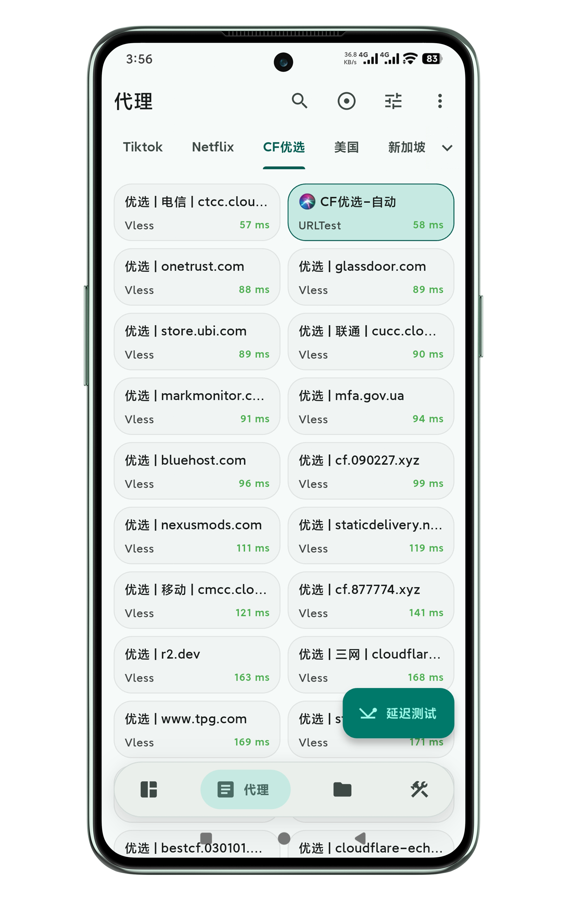
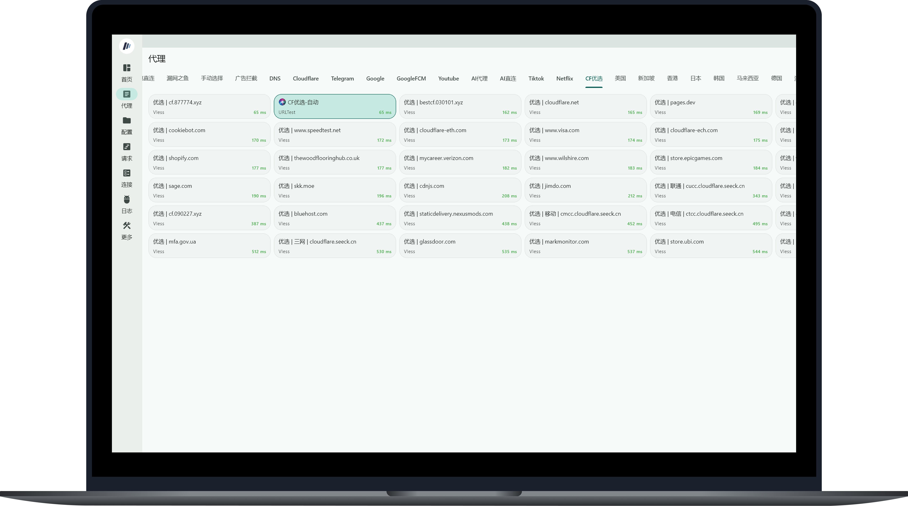
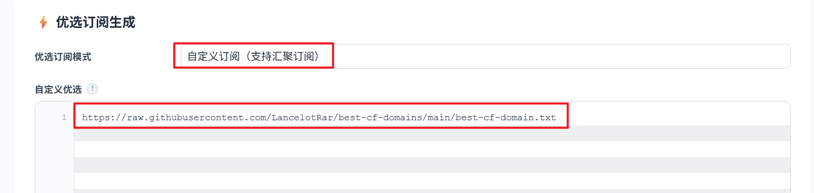
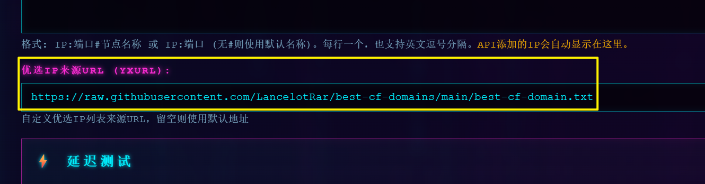

<div align="center">

# Cloudflare 优选域名 API
### Cloudflare 优选域名，服务于 Cloudflare 免费代理搭建方案，优质域名即为优质节点

  <a href="https://t.me/liqunchannel"></a>

</div>

## 应用效果

- 转换后的优选域名将成为代理节点，具体表现取决于使用者当地网络环境，仅供参考。点击查看清晰图

<p align="center">
   
</p>

## 项目说明

- 提供 “**全量优选域名 API**”
- 提供 “**Lite版优选域名 API**”
- 可接入 [**Cmliu/edgetunnel**](https://github.com/cmliu/edgetunnel)-"自定义订阅汇聚"，和 [**byJoey/cfnew**](https://github.com/byJoey/cfnew) -"优选IP来源URL"，从而将优选域名转换为代理节点。建议具备相应项目基础的用户使用
- 优选域名通常依赖于那些在国际/国内互联表现极佳、且本身受到良好维护的“大厂”，它底层的 IP 调度和容灾由服务方或系统自动处理，**不需要用户天天操心换优选 IP**
- 可以直接利用成熟的多线路解析的 DNS 服务商，实现多运营商优化，对复杂网络环境的兼容性更好
- 优选域名往往使用了一些未被重点照顾、或者网络权重更高的 Cloudflare 边缘节点入口，能够有效避开部分运营商对常规 Cloudflare IP 段的本地阻断，连接成功率更高
- 如有帮助，请多多star

## 接入指南

<table>
  <thead>
    <tr>
      <th><div align="center">项目</div></th>
      <th><div align="center">操作示意</div></th>
    </tr>
  </thead>
  <tbody>
    <tr>
      <td valign="middle"><strong>Cmliu/edgetunnel</strong><br>1. 复制粘贴 API 链接至“自定义优选”框中（无需点开下方“订阅接口”按钮）<br>2. <strong><ins>支持填入多个 API 链接</ins></strong><br>3. 保存</td>
      <td align="center" valign="middle"></td>
    </tr>
    <tr>
      <td valign="middle"><strong>byJoey/cfnew</strong><br>1. 复制粘贴 API 链接至“优选 IP 来源 URL” 框中<br>2. <strong><ins>仅支持填入单个 API 链接</ins></strong><br>3. 保存</td>
      <td align="center" valign="middle"></td>
    </tr>
  </tbody>
</table>

## API 详情

- 优选域名较为稳定，不会频繁更新，依使用体感酌情少量增删
- 全量优选域名 API

```
https://raw.githubusercontent.com/LancelotRar/best-cf-domains/main/best-cf-domain.txt
```

- Lite（精简）版优选域名 API

```
https://raw.githubusercontent.com/LancelotRar/best-cf-domains/main/best-cf-domain-lite.txt
```

## 相关视频教程
- 参考 [**Cloudflare 优选 IP API 教程演示**](https://github.com/LancelotRar/best-cf-ips#api-教程演示)

## 项目热度

<p align="center">
<a href="https://www.star-history.com/?repos=lancelotrar%2Fbest-cf-domains&type=timeline&legend=top-left">
 <picture>
   <source media="(prefers-color-scheme: dark)" srcset="https://api.star-history.com/chart?repos=lancelotrar/best-cf-domains&type=date&theme=dark&legend=top-left" />
   <source media="(prefers-color-scheme: light)" srcset="https://api.star-history.com/chart?repos=lancelotrar/best-cf-domains&type=date&legend=top-left" />
   
 </picture>
</a>
</p>